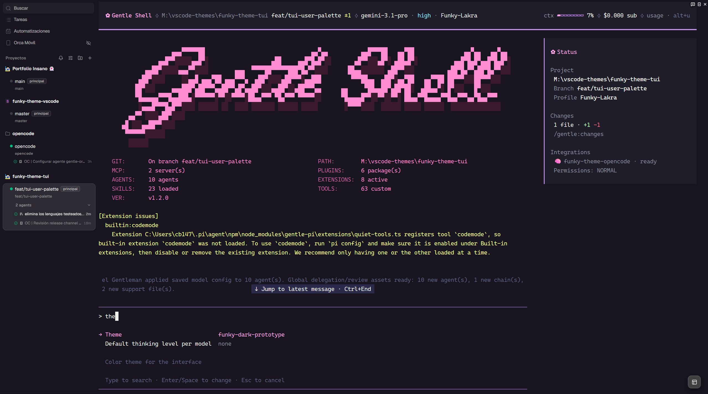
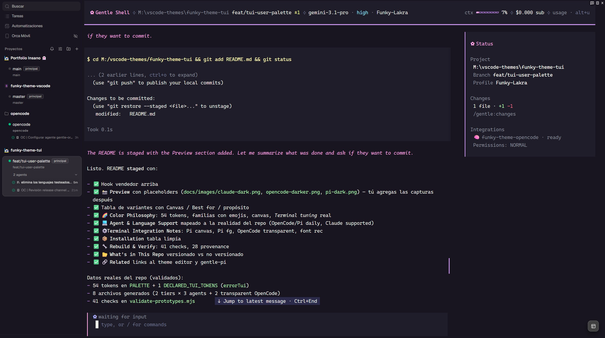
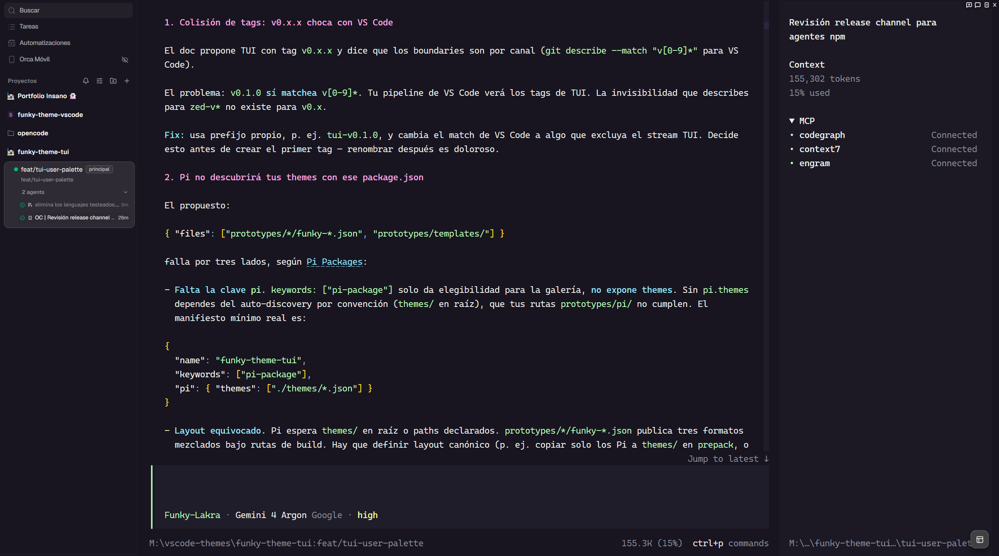
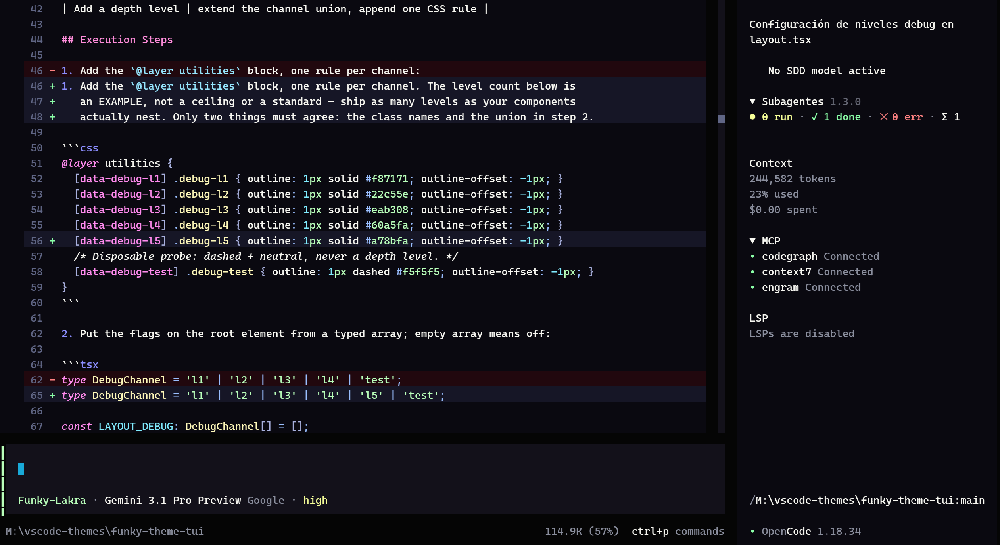
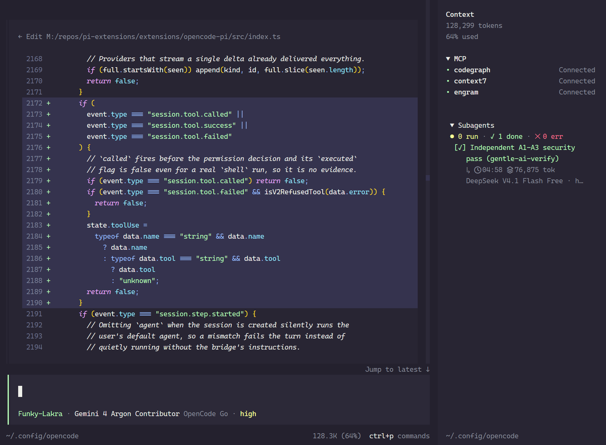
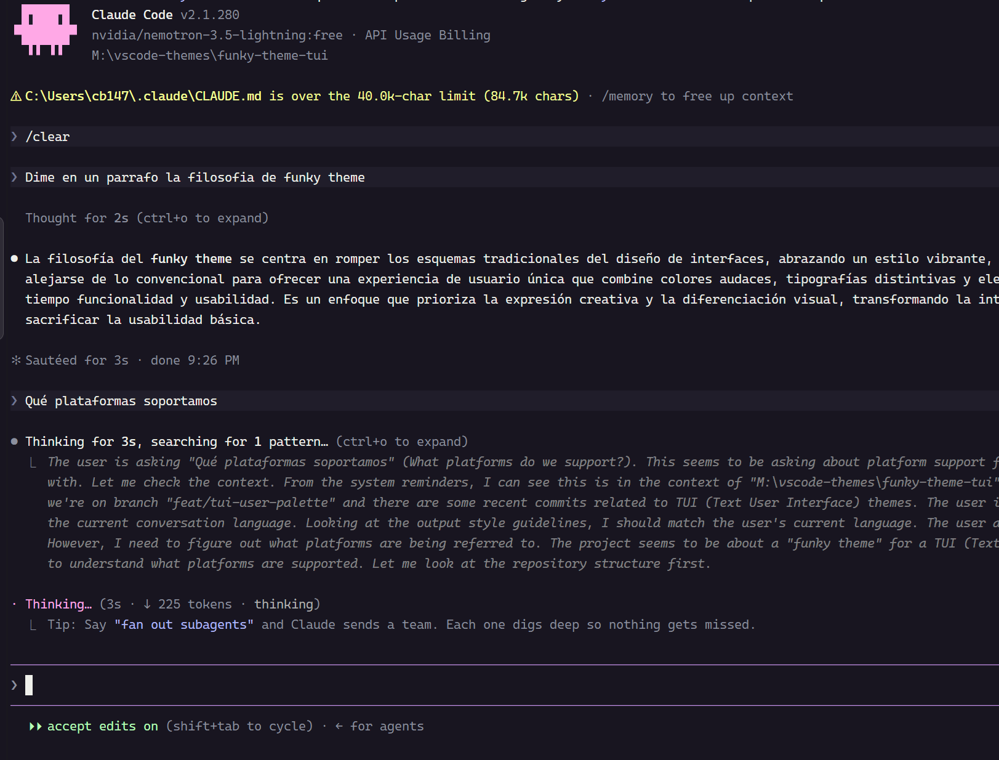

# Funky Theme for AI Coding Agents 👻

> A vibrant, semantically-driven theme for **Claude Code**, **OpenCode**, and **Pi/Gentle-Shell** — bringing Funky's color DNA to the terminal where you actually live.

Agents answer in markdown. That *is* the surface you read — which is why this palette is deliberately a step calmer than the editor's. In the IDE, markdown is a minor surface and was tuned hot; in a terminal it is every line, at full size, for hours. Same families, fewer decibels, because you live here.

**🧪 Prototype** — palettes under visual review. Theme files carry the `-prototype` suffix until the stable release drops it. [`SOURCES.md`](SOURCES.md) tracks provenance and rationale.

> 🧩 **Looking for the IDE version?** Get Funky Theme for [VS Code Marketplace](https://marketplace.visualstudio.com/items?itemName=MaxGB23.funky-theme-vscode) · [Open VSX](https://open-vsx.org/extension/MaxGB23/funky-theme-vscode) (Cursor, Antigravity VSCodium) · [Zed Extensions](https://zed.dev/extensions/funky-theme) · [Source Repo](https://github.com/maxgb23/funky-theme)

---

## 📸 Preview

<p align="center"><strong>Funky Dark — Pi (Gentle Shell)</strong></p>

<p align="center">
  
</p>

<p align="center"><strong>Funky Dark — Pi (Gentle Shell, session)</strong></p>

<p align="center">
  
</p>

<p align="center"><strong>Funky Dark — OpenCode</strong></p>

<p align="center">
  
</p>

<p align="center"><strong>Funky Darker — OpenCode</strong></p>

<p align="center">
  
</p>

<p align="center"><strong>Funky Classic — OpenCode (work in progress)</strong></p>

<p align="center">
  
</p>

**Funky Classic** is chain step 0: the palette's own canvas, `#24212e` — the exact surface the VS Code theme is built on. `dark` and `darker` are its terminal-tuned derivatives; this is the origin, same hues and same semantic roles, with nothing stepped down.

> Not shipped yet: no builder entry, provisional elevation, and it exists because this canvas was once rejected here as too bright for a terminal — this is the retest. It is not one of the **8 files** listed below.

<p align="center"><strong>Funky Dark — Claude Code</strong></p>

<p align="center">
  
</p>

---

## 💻 Agent Support

Optimized for the workflows you actually run in the terminal:

- **OpenCode** — full support, solid + transparent variants (tested daily). 50 keys: 14 markdown, 9 syntax, 12 diff, 15 chrome.
- **Pi / Gentle-Shell** — full support, uses your terminal bg for canvas (tested daily). 59 slots (56 `colors` + 3 `export`) over a 27-entry `vars` palette — inside `colors`: 10 markdown, 9 syntax, 3 diff, 8 thinking, 4 identity, 22 chrome.
- **Claude Code** — supported (`custom:` prefix required); tested in real sessions, though with less visual mileage than OpenCode and Pi. 72 slots, no markdown and no code keys.

---

## 🎨 Variants — Two depths, one palette

Terminal developers read differently. Some want balanced contrast for long sessions, some want near-black for zero distraction. Two variants, one palette — the tiers differ only in surface depth, never in hue:

| Variant | Canvas | Best for | Claude Code | OpenCode | Pi |
|---|---|---|---|---|---|
| **Funky Dark** | `#181520` (gray-mauve) | Balanced contrast, vivid semantics — the daily driver | ✅ | ✅ | ✅ |
| **Funky Darker** | `#0a0910` (near-black) | Ultra-nocturnal, zero-distraction focus sessions | ✅ | ✅ | ✅ |

**Transparent variants** (OpenCode only): identical semantics, `background: "none"` — inherits your terminal's bg. Claude Code and Pi can't express transparency, so no false variants are generated.

> **Surface ladder.** Three steps, two of them shipped: `step 0` `#24212e` (the editor canvas — **not shipped**, previewed above as `classic`) → `step 1` `#181520` (shipped as `dark`) → `step 2` `#0a0910` (shipped as `darker`). The editor's `Darker` becomes TUI `dark`; TUI `darker` pushes deeper. OpenCode's panel surface follows the tier one lift below elevated: `#1c1925` / `#0f0d15`.

**8 files total**: 2 tiers × 3 agents + 2 transparent (OpenCode only).

---

## 📦 Installation

| Agent | Path | Config |
|---|---|---|
| **Claude Code** | `~/.claude/themes/` | `{ "theme": "custom:funky-dark-prototype" }` |
| **OpenCode** | `~/.config/opencode/themes/` | `{ "theme": "funky-dark-prototype" }` |
| **Pi** | `~/.pi/agent/themes/` | `{ "theme": "funky-dark-prototype" }` |

1. Copy the `.json` for your variant to the agent's theme directory
2. Add the config snippet to the agent's settings file
3. Restart the agent

> **Prototype names**: the `-prototype` suffix keeps cleanup a single glob while palettes are under review. The stable release drops it.

---

## 🌈 Color Philosophy — one palette, three vocabularies

Funky's palette is **54 named tokens**, inherited from the editor theme. The TUI keeps those names and their hues, and declares the few extra values the editor has no token for:

| Declared for the TUI | Value | Why it exists |
|---|---|---|
| `errorTui` | `#ff718f` | Terminal-tested error; the editor's `errorFg` reads differently on a dark canvas |
| `textTui` | `#eff0eb` | Body copy, distinct from identifier text |
| `commentTui` | `#8e8ea7` | Dim comment, between `muted` and `dim` |
| `panelTui` / `selectionTui` | per tier | Surfaces the chain does not produce |

**In the IDE, Funky's philosophy is total visual clarity: dissecting complex code effortlessly across semantic families so everything is parsed at a glance—outperforming typical dark themes that blend into monochromatic mud.**

**In terminals, there are no thousands of syntax tokens.** Terminal agents only expose a handful of keys (and mostly output markdown or minimal diffs). You cannot replicate IDE-level micro-tokenization here. Instead, our goal shifts: **cure the dull dark terminal.** We bring Funky's vibrant, high-contrast DNA to CLI workflows so long agent sessions remain energetic, readable, and alive—adapting our semantic families to whatever vocabulary each agent actually provides:

| | Claude Code | Pi | OpenCode |
|---|---|---|---|
| **Slots the theme can paint** | **72** | **59** (56 `colors` + 3 `export`) | **50** |
| **Distinct colors actually used** | 23 | **19** | 23 |
| **Palette behind the slots** | 72 literals | **27 `vars`** (21 distinct values) | 50 literals |
| Markdown roles | — | 10 | 14 |
| Code roles (`syntax*`) | — | 9 | 9 |
| Diff roles | 6 | 3 | 12 |
| Thinking / effort | 1 | 8 | — |
| Agent identity & labels | 22 | 4 | — |
| Chrome | 43 | 22 | 15 |

> Pi's role counts cover its 56 `colors`; `export` adds three more surfaces (page, card, info).
> Pi is the **smallest palette of the three and paints the most slots with it**: 19 distinct colors recycled across 56 slots, from a 27-entry `vars` table.

Three things follow from that table, and they are the whole story of this theme:

- **Code survives as a minority voice.** OpenCode and Pi color code with 9 `syntax*` keys each — 18% of OpenCode's keys and 15% of Pi's slots. The vocabulary is exactly: comment, function, variable, string, number, type, operator, punctuation, keyword. No tags, no attribute names, no import groups — those editor roles have no key here.
- **Markdown outranks code in both.** OpenCode exposes 14 markdown slots (heading, link, link text, strong, emphasis, inline code, fenced block, block quote, list item, list enumeration, horizontal rule, image, image alt text, body text); Pi exposes 10. That is where the color budget goes, because that is what gets read.
- **Claude Code can color neither.** Zero markdown keys and zero code keys in its 72. Its palette paints chrome, status, diffs — and identity: eight `*_FOR_SUBAGENTS_ONLY` slots named after colors (blue, cyan, green, orange, pink, purple, red, yellow) plus the `rainbow_*` ramp. The pink that means *tags* in the editor names a **subagent** there.

### What each family paints now

| Family | In the editor | OpenCode | Pi | Claude Code |
|---|---|---|---|---|
| 🩷 **Pinks** | Tags, parameters, numeric constants | Headings, image alt text | Headings, UI accent | Agent accent, subagent identity |
| 🟣 **Purples** | Keywords, flow control | Code keywords, image | Code keywords, links, list bullets | Subagent identity |
| 🩵 **Cyans** | Functions, regex punctuation, structural keywords | Functions, numbers, links, strong | Functions, numbers | Subagent identity |
| 🔵 **Blues** | Methods, symbol operators, storage modifiers | Symbol operators | Symbol operators | Subagent identity, professional blue |
| 🟡 **Yellows** | Type names, attribute names (HTML, CSS, JSX) | Types, list items, punctuation | Types | Subagent identity |
| 🟢 **Greens** | Strings, git untracked, inline code | Strings, inline code, block quotes | Strings, inline code | Added lines, subagent identity |
| 🔴 **Reds** | Errors, deleted refs | Errors, removed lines | Errors, removed lines | Errors, removed lines, subagent identity |
| 🟠 **Oranges** | `new`/operators, auxiliary keywords | — | — | Subagent identity |

Read the last three columns against the second and the honest summary is: **in a terminal only five families still do code work — purple, cyan, blue, yellow, green — red moved to status, and orange survives purely as an agent identity in Claude Code.** Pink lost its code role outright: the editor paints numbers pink, while both terminal agents paint the number slot cyan, alongside functions and punctuation. And comment is no longer a family color in either agent — a grey in both (`#8e8ea7` in OpenCode, `#8b8f9e` in Pi); Pi mutes punctuation to that same grey, while OpenCode gives punctuation a loud yellow.

**One shared canvas per variant.** Dark themes often default to deep blues — familiar but fatiguing. Funky uses a custom gray-mauve canvas (kinder to eyes at low brightness). Only `darker` goes deeper; the palette stays identical.

| Canvas | Variant |
|---|---|
| `#181520` gray-mauve | Funky Dark |
| `#0a0910` near-black | Funky Darker |

---

## 📉 Terminal Tuning — why it is calmer than the editor

**Markdown is the content, not a preview.** In the editor, markdown is a minority surface and was tuned hotter than the code *on purpose*: headings `#ff8ddb`, emphasis and links `#6df5fa`, against code keywords `#c792ea` and functions `#96e7ff`. A terminal inverts the ratio — every line an agent writes is markdown, painted at full size, for hours. So the TUI keeps every family and drops the top of each range:

| Role | Editor (markdown) | Funky TUI |
|---|---|---|
| Heading | `#ff8ddb` | `#ffa8e6` |
| Emphasis / link punctuation | `#6df5fa` | links and strong `#96e7ff`, emphasis muted |
| Inline code | `#b9ffba` | `#b9ffba` (unchanged) |

Hues never change; only the loudest step is removed. Syntax was re-tuned by hand instead — OpenCode's keyword slot moved brighter, to `#eaa9fc` — which is why this is selective, not a global desaturation.

**Backgrounds darker.** Terminal sessions run longer; deeper bases reduce glare. That is the surface ladder above, not a second palette.

**What does *not* change:**

- **Hues are frozen per family.** Nothing migrates across families: cyan never becomes pink.
- **Roles are per agent, not global.** Each vocabulary decides where a role lands (see below).
- **Values are tuned.** Where the editor's value fights the format, the TUI value wins — and the table above is the complete list of where.

---

## 🔀 Per-Agent Divergences — intentional, not drift

The same role can land on a different hue in two agents, and that is by design: **a vocabulary decides, not a preference.** These are declared, not accidental:

| Role | OpenCode | Pi | Why they differ |
|---|---|---|---|
| Link label | `#96e7ff` cyan | `#c792ea` purple | OpenCode routes links through the code cyan; Pi's graph routes `mdLink` through its `accent` var |
| Link URL | `#96e7ff` (shared with the label) | `#8b8f9e` muted | Pi has a dedicated URL slot and dims it; OpenCode does not |
| Heading | `#ffa8e6` | `#ffa8e6` | parity |
| Inline code | `#b9ffba` | `#b9ffba` | parity |
| Fenced block base | `#f8f8f2` identifier text | `#eff0eb` body text | OpenCode keeps `fgBase`; Pi paints it as copy |
| Block quote | `#b9ffba` green | `#8b8f9e` muted | OpenCode follows the green family; Pi keeps the template's muted edge |
| List marker | `#fff9b7` | `#c792ea` | OpenCode uses the type yellow; Pi uses the accent var |
| Strong | `#96e7ff` cyan | *no slot* | Pi's vocabulary has no emphasis or strong key |
| Emphasis | `#8b8f9e` muted | *no slot* | same |
| Horizontal rule | `#544f64` | `#544f64` | parity |
| Keyword (code) | `#eaa9fc` | `#c792ea` | OpenCode re-tuned it brighter; Pi keeps the editor's purple |
| Number (code) | `#96e7ff` | `#80ecff` | cyan in both, different step |
| Punctuation (code) | `#ffde25` | `#8b8f9e` | OpenCode gives punctuation a loud yellow; Pi mutes it |

**Pi is two layers, and this trips people up.** In Pi, a value in `colors` is not a color — it is the *name of a `vars` entry*. So `colors.mdLink = "accent"` and `colors.accent = "softRose"` are unrelated: the first resolves through `vars.accent` (purple), the second names a different slot (pink). Pi's links are purple and its UI accent is pink, from the same word.

**Only OpenCode and Pi can paint markdown and code at all.** With zero markdown and zero code keys, Claude Code has no way to color either — its theme is chrome, status, diffs and agent identity.

---

## ⚙️ Terminal Integration Notes

### Canvas & Background Recommendations
* **Solid canvas in Pi (optional)**: **Pi doesn't paint the canvas natively** — it inherits your terminal's background. If you want a matching solid look, set your profile bg to `#181520` (Dark) or `#0a0910` (Darker). Power users with customized terminal colors, blur, or transparency can ignore this.
* **Customizable OpenCode variants**: OpenCode ships both **solid** and **transparent** variants to adapt to any setup:
  * *Solid*: Paints its own background explicitly (`background` with color).
  * *Transparent* (`"background": "none"`): Passes through your terminal's background, ideal if you use blur, custom window opacity, or underlying terminal backgrounds.

### Foreground & Typography
* **Pi text inheritance**: The assistant body in Pi uses your terminal's default foreground, not the theme's `text` variable (Pi's vocabulary lacks a markdown body-text slot, whereas OpenCode has one). If text looks off in one terminal vs another, check that profile's default foreground and ANSI palette.
* **Terminal Font Configuration**:
  > **Note**: These settings work on **any terminal emulator or IDE that supports font customization** (WezTerm, Ghostty, Alacritty, Kitty, Windows Terminal, Orca IDE, etc.). These are the exact values the maintainer uses daily in Orca IDE; feel free to adjust them to your personal taste:

  ```json
  {
    "fontFamily": "Cascadia Code",
    "fontSize": 17,
    "fontWeight": 375,
    "fontWeightBold": 425,
    "lineHeight": 1.35
  }
  ```
  > Not bundled, falls back to system default font if missing.

---

## 🔧 Rebuild & Verify

```bash
node prototypes/build-prototypes.mjs       # emits 8 JSONs from 54 palette tokens
node prototypes/validate-prototypes.mjs    # 41 checks on generated artifacts
node scripts/check-upstream.mjs             # 28 provenance checks (read-only)
```

- **Deterministic build** — re-run on clean tree = zero byte diff. Generated artifacts versioned without golden-file comparison.
- **`check-upstream.mjs`** — read-only drift detector. Verifies every registered artifact and Pi upstream file by SHA-256. Exits 1 on any failure. Never writes or deletes.

---

## 📂 What's in This Repo

**Versioned**: generation/validation scripts (`prototypes/`), palette tokens, 8 generated JSONs.

**Not versioned**: base templates and `Gentleman-Cute` theme (palette source). `Gentleman-Cute` is used as our reference baseline because it is the official theme of **Gentle-Shell**. If Gentle-Shell introduces any new theme keys upstream, `check-upstream.mjs` catches the non-byte-identical diffs so we can add support immediately. Under the hood, Gentle-Shell runs on **Pi**, which means vanilla Pi is inherently and fully supported. These upstream assets live in the `gentle-pi` npm package; committing them would be unauthorized distribution. `.gitignore` excludes them; `check-upstream.mjs` fails if any appear.

---

## 🔗 Related
 
- **Funky Theme for IDEs** — [VS Code Marketplace](https://marketplace.visualstudio.com/items?itemName=MaxGB23.funky-theme-vscode) · [Open VSX](https://open-vsx.org/extension/MaxGB23/funky-theme-vscode) (Cursor, Antigravity) · [Zed Extensions](https://zed.dev/extensions/funky-theme) · [GitHub Repo](https://github.com/maxgb23/funky-theme)
- **Gentle Shell (Pi agent harness)** → [gentle-shell](https://github.com/Gentleman-Programming/gentle-shell)
